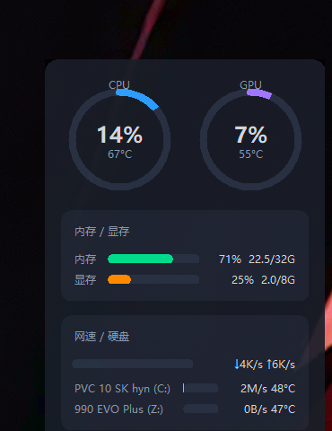

# 系统资源面板 SystemPanel

一个贴在 Windows 桌面壁纸上的实时资源挂件：3 秒自动刷新、不挡桌面图标、没有任何交互，开着电脑就能一眼看到 CPU、内存、硬盘、GPU、网络的实时状态。

它做的事相当于把任务管理器里最常盯的几块信息压缩成一张小卡片，常驻在壁纸层——不用切窗口，也不用把任务管理器摆在桌面上挡事。



> **需要管理员权限**：CPU 温度、硬盘温度依赖底层硬件读取，没有提权只能看到占用率/速率，看不到温度。
> 面板会检测权限，没提权时底部会有一行提示。开机自启默认就是提权跑的，不用操心。

## 特性

- **嵌入壁纸层**：无边框、半透明，鼠标穿透不挡桌面图标
- **聚焦可拖、失焦上锁**：点一下面板获得焦点拖动位置，点别处自动锁定并记住位置
- **多显示器**：可指定显示在第几块屏，换显示器布局后自动钳制回可见区
- **休眠盘跳过**：外接机械盘休眠时不唤醒、不检测（仅 USB 外接盘参与判定，NVMe 永不误判）
- **优雅降级**：非管理员权限下温度项留空，其他指标正常显示
- **开机自启**：计划任务 + 最高权限 + 后台运行（无控制台窗口），任务超时设为无限制、崩溃自动重启

## 技术栈

**本体**：Python 3.10 + Tkinter。界面上的圆环、圆角卡片、进度条全是 Canvas 自绘，不依赖第三方 GUI 控件库（`panel/widgets_tk.py`）。早期的 PySide6 版本还留在 `panel/app.py`、`panel/widgets.py`，已不是默认路径，仅作参考保留。

**接入的系统接口**（均为 Windows 专属口径）：

| 库 / 接口 | 负责什么 |
|---|---|
| pywin32 + ctypes（Win32） | 定位壁纸层 `WorkerW` 并 `SetParent` 挂进去、`WS_EX_TRANSPARENT` 鼠标穿透、`SetLayeredWindowAttributes` 半透明、`EnumDisplayMonitors` 枚举多显示器并钳制位置 |
| psutil | CPU / 内存占用率与容量、网卡级收发字节 |
| nvidia-ml-py（NVML） | GPU 占用率、温度、显存 |
| win32pdh（PDH） | 硬盘 `% Disk Time` 繁忙率 |
| WMI（win32com） | 物理磁盘型号、物理网卡名单（据此排除虚拟网卡 / WSL / loopback） |
| pythonnet（`clr`）+ LibreHardwareMonitorLib.dll | CPU 与硬盘温度（第三方 DLL 不随仓库分发，见"快速开始"第 2 步） |

**打包**：PyInstaller 打成单文件 `SystemPanel.exe`（onefile + windowed + uac_admin），面板本体则是 `panel/` 目录下的纯 Python 源码。

各指标具体取哪个字段、为什么这么算，见下表。

## 指标口径

| 指标 | 数据来源 | 说明 |
|---|---|---|
| CPU 占用 | psutil | 距上次采样窗口的全核平均 |
| CPU 温度 | LibreHardwareMonitor | 需管理员权限 |
| GPU 占用 / 温度 | NVIDIA NVML | 需 N 卡 + `nvidia-ml-py` |
| 内存 / 显存 | psutil / NVML | 占用率 + 已用/总量 |
| 硬盘繁忙率 | PDH `% Disk Time` | psutil 的 I/O 时间计数在 NVMe 上精度丢失（延迟只有几十微秒，累计值≈0），实测恒为 0，故改用 PDH；满速写入也只到 ~46%，这是 Windows 按"有未完成 I/O 的时间占比"算的，非线性 |
| 硬盘读写速率 | 字节差分 / 时间窗口 | 与 I/O 时间无关，NVMe 上也准确 |
| 网速 | psutil per-NIC + WMI 筛选 | 只统计物理有线/无线网卡（`PhysicalAdapter=TRUE` 且为 802.3），排除虚拟网卡 / WSL / loopback；16 KiB/s 以下视为噪声 |

## 快速开始

### 便携版（推荐）：`dist/SystemPanel.exe`

单文件免安装（约 16MB），双击即跑：

- 默认申请管理员权限（弹一次 UAC），温度全显示；**非管理员运行会缺 CPU/硬盘温度**（占用率、网速、内存等不受影响）
- **右键菜单**：在面板上点右键 → `开机启动`（打勾即计划任务自启，最高权限）/ `退出`
- 面板被别的窗口盖住时，右键不会误触（只响应真正露出来的面板）
- 自启任务指向当前 exe 路径；如果移动了 exe，在菜单里关一次再开一次即可
- 日志在 `~/.task_manager/panel.log`，排错用
- 自己打新版：`pip install pyinstaller` 后 `pyinstaller SystemPanel.spec`（产物在 `dist/`，不进仓库）

### 源码版

不想用 exe 就按源码跑，需要自己的 Python 环境：

### 环境要求

- Windows 10 / 11，Python 3.10+
- N 卡用户另需 NVIDIA 驱动（GPU 温度/占用）；核显-only 机器 GPU 环为空

### 1. 安装依赖

```powershell
pip install -r requirements.txt
# psutil / nvidia-ml-py / pythonnet / pywin32（温度与硬盘相关功能仅 Windows 可用）
# tkinter 为 Python 内置，无需安装；旧 Qt 版本见下文
```

### 2. 下载 LibreHardwareMonitor（温度必需）

温度读取依赖 `LibreHardwareMonitorLib.dll`，二进制不随仓库分发：

1. 去 [LibreHardwareMonitor releases](https://github.com/LibreHardwareMonitor/LibreHardwareMonitor/releases) 下载对应版本
2. 解压后把 `LibreHardwareMonitorLib.dll` 及其同目录依赖放到 `_engine/LibreHardwareMonitor/`
3. 面板只加载 `LibreHardwareMonitorLib.dll` 这一个文件（`.exe` / `.pdb` / `.xml` / 语言包都不需要）

### 3. 运行

```powershell
# 手动运行（普通权限，无 CPU/硬盘温度）
python -m panel

# 管理员权限（完整温度显示）：右键 PowerShell → 以管理员身份运行，再执行上面命令
```

### 4. 开机自启（推荐）

右键 `install.bat` → **以管理员身份运行**。它会：

1. 关闭旧面板进程（避免重叠）
2. 清理历史遗留任务
3. 创建计划任务 `SystemPanel`：Logon 触发 + 最高权限 + `pythonw` 后台运行 + 超时无限制 + 崩溃自动重启
4. 立刻在后台启动面板

不想用了就以管理员身份运行 `uninstall.bat`。

## 配置

`~/.task_manager/panel_config.json`（面板拖动后自动生成/更新）：

```json
{
  "monitor": 1,
  "x": 1234,
  "y": 56
}
```

- `monitor`：显示在第几块显示器（1/2/3…）
- `x` / `y`：面板位置，拖动后自动记忆

## 文件结构

```
task_manager/
  install.bat            # 一键安装：开机自启 + 管理员 + 后台启动
  uninstall.bat          # 卸载：停面板 + 删计划任务
  requirements.txt
  panel/
    __main__.py          # 入口：默认 tkinter 版（无第三方 GUI 依赖）
    app_tk.py            # 面板主程序（布局、轮询、位置记忆）
    widgets_tk.py        # 自绘控件（圆环/进度条/卡片）
    collector.py         # 指标采集（psutil / NVML / PDH / LHM）
    app.py / widgets.py  # 旧 Qt(PySide6) 版本，已非默认，仅保留
    wallpaper.py / sleep.py
  _engine/               # 第三方二进制（不进仓库，见上文下载说明）
```

## 常见问题

**Q: 温度显示为空？**
A: 需要管理员权限，用 `install.bat` 安装自启，或手动以管理员身份运行。

**Q: 面板重叠/有两个？**
A: 启动前会自动清旧进程。还重叠就去任务管理器结束所有 `python.exe` / `pythonw.exe`。

**Q: 如何停止面板？**
A: 任务管理器 → 结束 `pythonw.exe`；彻底停用再运行 `uninstall.bat`。

## 已知局限

- `% Disk Time` 满速下也到不了 100%（见上表），进度条按 0–100 clamp 显示
- 网速满格按 100 MiB/s 标定（千兆口单向上限约 118 MB/s）
- 仅 Windows（PDH / WMI / pythonnet 均为 Windows 口径）

## 第三方组件与许可

本项目自身以 [MIT](LICENSE) 开源。

| 组件 | 用途 | 许可 |
|---|---|---|
| [LibreHardwareMonitor](https://github.com/LibreHardwareMonitor/LibreHardwareMonitor) | CPU / 硬盘温度（面板用 pythonnet 加载其 `LibreHardwareMonitorLib.dll`） | [MPL-2.0](https://www.mozilla.org/MPL/2.0/) |
| psutil | CPU / 内存 / 网卡收发字节 | BSD-3-Clause |
| nvidia-ml-py | GPU 占用率、温度、显存（NVML） | BSD |
| pywin32 | 壁纸层嵌入、PDH、计划任务 | PSF |
| pythonnet | 加载 LibreHardwareMonitor 的 .NET 程序集 | MIT |
| PySide6-Essentials | 仅旧版 Qt 代码路径使用，已非默认 | LGPL-3.0-only OR GPL-2.0-only OR GPL-3.0-only |

**关于 MPL-2.0 的合规说明**：LibreHardwareMonitor 是 MPL-2.0 覆盖的第三方代码，本仓库**源码不分发**它的二进制文件，请按"快速开始"第 2 步自行下载。Release 附带的单文件 exe 内部打包了该 DLL，属于 MPL-2.0 允许的可执行形式分发，但分发时须满足 MPL-2.0 §3.2 的义务，因此在此明确声明：

- MPL-2.0 覆盖的文件（`LibreHardwareMonitorLib.dll` 及其同目录依赖）的完整源码，可从上表官方仓库获取
- 该组件的版权声明与许可条款随该仓库一并提供，未作删改

`install.bat` 里的 Python 环境路径、以及文档中提到的本机路径为本机专有，拿到源码后请按自己机器修改再用。
